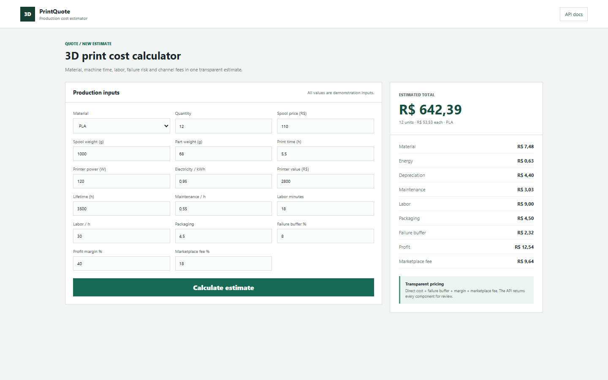
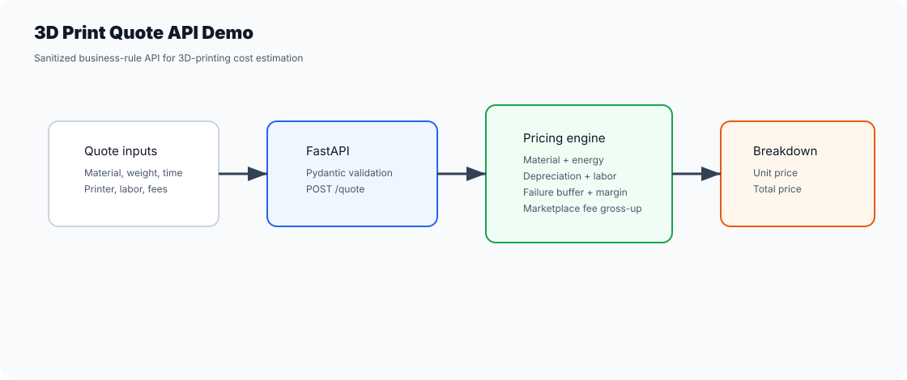

# 3D Print Quote API Demo

[English / README principal](README.md) · Português (Brasil)

Demonstração FastAPI com informações sensíveis removidas para calcular orçamentos de impressão 3D a partir de dados comerciais fictícios.

## Captura de tela





Este repositório se baseia em experiências reais com orçamentos de impressão 3D, mas não contém dados de clientes, banco de dados privado, materiais de identidade de marca nem segredos de produção.

## O que demonstra

- Design de APIs de backend com FastAPI e Pydantic.
- Lógica de precificação para material, energia, depreciação, manutenção, mão de obra, embalagem, reserva para falhas, margem de lucro e taxa do marketplace.
- Validação de entradas inseguras, como percentuais inválidos de taxa do marketplace.
- Testes do mecanismo de precificação e do contrato da API.
- CI com GitHub Actions para a suíte de testes.

## Execução local

```bash
python -m venv .venv
.venv\Scripts\activate
python -m pip install -r requirements.txt
python -m uvicorn app.main:app --reload
```

Abra a calculadora:

```text
http://127.0.0.1:8000
```

A documentação interativa da API continua disponível em `http://127.0.0.1:8000/docs`.

## Exemplo de requisição

```bash
curl -X POST http://127.0.0.1:8000/quote \
  -H "Content-Type: application/json" \
  -d "{\"material_name\":\"PLA\",\"filament_spool_price\":100,\"filament_spool_weight_g\":1000,\"part_weight_g\":50,\"print_hours\":5,\"printer_power_w\":100,\"electricity_price_kwh\":1,\"printer_price\":2500,\"printer_lifetime_hours\":2500,\"maintenance_cost_per_hour\":0.5,\"labor_minutes\":30,\"labor_hour_price\":30,\"packaging_cost\":4,\"failure_rate_percent\":10,\"profit_margin_percent\":40,\"marketplace_fee_percent\":20,\"quantity\":2}"
```

## Testes

```bash
pytest
```

## Notas de portfólio

Este projeto é intencionalmente pequeno e focado. Ele mostra como transformo um fluxo operacional real em uma demonstração pública segura, com regras de negócio claras, validação, testes e documentação.
